# Project governance & contribution

Welcome to the **fluxrig** institutional engineering hub. This section defines the governance model, contribution workflows, and licensing boundaries for the project. Our goal is to maintain an open-core ecosystem where architectural integrity, operational safety, and **Technical Autonomy** are never compromised.

To start contributing, follow the standard build and test cycle:

```bash
# Clone & Setup
git clone https://github.com/jaab-tech/fluxrig.git
cd fluxrig

# Build Toolchain (Binaries + Catalog)
make build

# Add to PATH (Optional but Recommended)
export PATH=$PATH:$(pwd)/bin
```

## Local validation loop
Before submitting a Pull Request, verify your changes using the institutional validation loop:

```bash
make lint       # Security & Style check
make test       # Core Logic check
make test-robot # Protocol Integrity check
make regression # System E2E check
```

---

## Before you open a pull request

Every pull request must reference an issue. Open the issue first, and describe the problem or the change. For a large change, agree on the approach with a maintainer before you write code. Then create your branch from `dev`, open the pull request against `dev`, and put `Closes #<issue>` in its body.

Community pull requests target `dev`, not `main`. A maintainer reviews your pull request and squash-merges it on `dev`. The next release then adds your commit, with your name, to the history of `main`. Public `main` is the release line, and only a release changes it.

Do not edit `CHANGELOG.md`. The maintainers write the entry when they prepare the release that carries your change, and they credit you in it. You see your entry when the maintainers publish that release.

Do not name another company's commercial product in source comments, help text, schema descriptions, file names or test names. Describe the format instead, for example "zero-padded ASCII decimal digits, e.g. `0123`". The products that the project uses, such as NATS and DuckDB, are fine. A protocol, standard or scheme name is fine when the code handles it, such as ISO 8583 or `variant: "visa"`. A product name in the code compares or implies a relationship that nobody can check. It stays in the history after the pull request merges.

You do not need to write the documentation for a code change. Describe what a user sees in the body of your pull request. List new or changed configuration keys with their defaults, flags, and any change in behaviour. The maintainers write the pages and publish them with the release that carries your change.

To change a page yourself, open an issue in the [fluxrig repository](https://github.com/jaab-tech/fluxrig/issues) and name the page. Issues are off in the documentation repository. Then send a pull request to [fluxrig/docs](https://github.com/fluxrig/docs) that references the issue (`Closes jaab-tech/fluxrig#<number>`). A maintainer does not merge it there, because each release replaces the content of that repository. The maintainer checks your change, applies it to the source of the site, and closes your pull request with a note that names the release. The changelog credits you by name.

The maintainers close a pull request that has no linked issue, and ask for an issue first.

The reason is simple. The issue holds the discussion and the decision. The pull request holds the code. A reviewer can then check the code against the agreed change, and the history keeps the reason next to the change.

One issue, one change. Split unrelated work into separate issues and pull requests. If your change needs an enterprise gear (`sim_source`, `sim_responder`), say so on the issue first. Those gears live in a separate repository, and a pull request here must not depend on them.

The command-line tool `iso8583-tool` is a wire-level instrument for the project's own test suites. It takes fixes, and options for the wire formats that the gears support, such as a length-prefix style. It does not gain new modes or behaviour, such as a responder. Build those as a scenario. If a scenario cannot express what you need, open an issue and describe it.

---

## The developer journey
Navigating an orchestration platform requires a clear roadmap. We maintain an institutional four-stage process from induction to production.

```mermaid
graph LR
    A["Architectural Induction"] == "Setup Environment" ==> B["Implementation"]
    B == "Writing Gears/Logic" ==> C["Verification"]
    C == "CI/Regression Pass" ==> D["Contribution"]
    D == "PR & Sign-off" ==> E["Release"]

    %% Institutional Palette
    style A fill:#f1f3f4,stroke:#3c4043,stroke-width:2px;
    style B fill:#f1f3f4,stroke:#3c4043,stroke-width:2px;
    style C fill:#f1f3f4,stroke:#3c4043,stroke-width:2px;
    style D fill:#f1f3f4,stroke:#3c4043,stroke-width:2px;
    style E fill:#1a73e8,stroke:#1a73e8,stroke-width:3px,color:#fff;
```



### Phase: architectural induction
Start by aligning your local workstation with the **[Environment & layout](environment.md)** guide. You need a "Dual Head" setup (Mixer + Rack) to verify logic end-to-end.

### Phase: implementation
Follow the **[Developing specialized gears](../tutorials/writing_gears.md)** tutorial. Ensure all new code adheres to the **[Engineering standards](standards.md)**. Focus on context propagation, error wrapping, and structured logging.

### Phase: verification
We maintain a "Hard Engineering" posture. Every contribution is a reflection of the system's overall reliability and is not complete until it passes every verification layer:

*   **Unit & Integration**: `make test` (Minimum 60% coverage).
*   **Protocol Integrity**: `make test-robot` (Real-world signal validation via Robot Framework).
*   **System Regression**: `make regression` (Full E2E parity).

---

## Governance & integrity

### Developer Certificate of Origin (DCO)
To protect the open-source integrity and maintain clear licensing boundaries, **fluxrig** requires a **[DCO 1.1](https://developercertificate.org/)** sign-off on every commit. This is a legally binding statement that you have the right to submit the code.

### AI code hygiene (Human accountability protocol)
We embrace AI-assisted engineering but maintain absolute human accountability. We treat AI-generated code as a third-party dependency:

1.  **Deterministic Validation**: Every AI-assisted contribution must pass functional validation via the full institutional test suite.
2.  **Architectural Curation**: The human author must ensure AI-generated blocks adhere to the project's **[Engineering standards](standards.md)** and naming conventions (**Mixer**, **Rack**, **Gear**).
3.  **Institutional Accountability**: The human engineer signing the **DCO sign-off** takes full responsibility for the code's performance, security, and long-term maintainability. 

> [!IMPORTANT]
> We view AI as an augmentation tool, but the **Human Architect** remains the final arbiter of what the system does.

### Dependency hygiene
We maintain strict compliance to ensure no "License Contamination":

*   **Permissive Linkage**: Use only libraries with Apache 2.0, MIT, or BSD-style licenses.
*   **AGPL Boundaries**: Access external services (e.g., Grafana) solely via network protocols. **Never** link against AGPL code.

---

## Licensing & commercial strategy

**fluxrig** operates under a **Loose Open Core** model. The boundary is a
principle rather than a list, so that it stays legible as the product grows.

*   **Foundation (Apache 2.0)**: It includes the core engine (`fluxrig`, `Rack`, `Mixer`) and every Gear that the project published in the [open repository](https://github.com/jaab-tech/fluxrig). The commitment is directional: **what the project published under Apache 2.0 stays under Apache 2.0**, in that version and in the ones that follow. The project never withdraws, relicenses, or moves anything already open behind a paywall later.
*   **Commercial**: Capability beyond that set. It includes:
    - Operational surfaces such as a visual console, role-based access control and an audit console over the log and registry data (the log persistence itself is in the open engine; the surface over it is here).
    - Long-term analytics.
    - Development and certification tooling.
    - Specialised or licensed protocol dialects.
    - Custom engineering.
    Some of it sits on the production path and some of it does not, so the line is not "free until the traffic is real". It is simply what is in the open set and what is additional to it.

Today that set is the gears that the project published under the [Enterprise offering](/docs/enterprise): `sim_source` and `sim_responder`. They use the [Business Source License 1.1](/docs/enterprise/licensing) in a separate repository from the engine. Each component states its licensing terms on its own page.

### Community engagement

*   **[Discord](https://discord.gg/drwSCCWFV7)**: Real-time architectural collaboration.
*   **[GitHub Issues](https://github.com/jaab-tech/fluxrig/issues)**: Official institutional tracking.
*   **Code of conduct**: The project bases decisions strictly on technical merit and benchmarked reality.