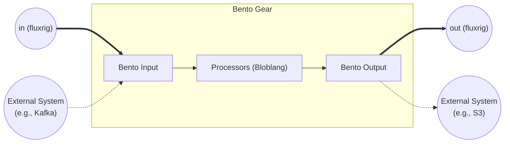

# Bento gear

The `bento` gear integrates the **Bento** engine (MIT Fork) into `fluxrig`. In the current release, it provides data mapping and logic via **[Bloblang](https://warpstreamlabs.github.io/bento/docs/guides/bloblang/about)** and **Standard I/O** (Files, Stdout). 

> [!NOTE]
> **Connector Status**: The Bento ecosystem supports 100+ connectors. The standard `fluxrig` binary currently includes the **Pure Logic** and **Local I/O** sets to maintain a lightweight footprint. **Institutional Connectors** (Kafka, SQL, AWS, etc.) are currently in the **future roadmap**. A custom binary build can enable them.

| Attribute | Details |
| :--- | :--- |
| **Source Code** | [pkg/gears/native/bento](https://github.com/jaab-tech/fluxrig/tree/main/pkg/gears/native/bento) |
| **Pairs With** | N/A (Universal Bridging) |
| **Always Emitted Metadata** | None (Inherits from Bento config) |
| **Conditionally Emitted Metadata** | None |
| **Mandatory Consumed Metadata** | None |
| **Optional Consumed Metadata** | None |
| **Signals Sent** | None |
| **Signals Subscribed** | None |

## Reference

`fluxrig gears doc bento` generates the identity, ports, and configuration below from the gear's manifest, so they stay in lockstep with the code.

<!-- AUTOGEN:manifest:bento START (generated by `fluxrig gears doc bento`; do not edit by hand) -->

| | |
|---|---|
| **Type** | `bento` |
| **Category** | logic |
| **Status** | stable |
| **Terminus** | opaque |

Wraps the Bento stream processor (file, socket, websocket and HTTP I/O, Bloblang mapping) as a gear.

**Ports**

| Port | Direction | Role | Summary |
|---|---|---|---|
| `in` | input | message | Message into the Bento pipeline (when an input port is declared). |
| `out.<name>` | output (dynamic) | message | Message out of a declared Bento output port. |

**Configuration**

| Field | Type | Required | Default | Description |
|---|---|---|---|---|
| `bento` | object |  | - | Embedded Bento config (input/pipeline/output), validated by Bento. |
| `log_level` | string |  | - | override the log level for this gear only (e.g. TRACE, DEBUG, INFO, WARN, ERROR). |
| `ports` | object |  | - | Declared input/output port names (bare names, e.g. 'in'/'out'); each maps to a wired flux endpoint. Omit for the implicit in/out pair. |
<!-- AUTOGEN:manifest:bento END -->

## Architecture



## Configuration safety
> [!IMPORTANT]
> **Strict Validation**: The Rack performs a "Dry Run" build of the Bento stream during startup. If your configuration is invalid (e.g., syntax errors, unknown plugins), the **Rack will fail to start**. This ensures strictly valid configurations in production.

## Description

The Gear automatically bridges `fluxrig` and Bento based on your `ports` definition. It attempts to **inject the missing side** of the pipeline:

1.  **Ingress (`fluxrig` -> Bento)**:
    *   If you define `ports.inputs`, the gear **injects** a `flux_in_<gearname>` input source into the Bento config.
    *   *Note: Auto-wiring currently only supports the primary (first) input. Multiple inputs require manual broker configuration.*

2.  **Egress (Bento -> `fluxrig`)**:
    *   If you define `ports.outputs` and **provide no Bento output**, the gear **injects** a `flux_out_<gearname>` output sink.
    *   If you define a complex `bento.output` (e.g., a `switch` for routing), you must manually target the `flux_out_<gearname>` plugin for internal ports.

## Seen in use

[Enriching an authorization with a network signal](../../tutorials/roaming_enrichment.md) uses one `bento` gear for a cache lookup and a policy decision. It makes an outbound HTTP call under a hard deadline. A second gear serves a simulated API from an `http_server` input. This case shows why a gear bringing its own input gets no injected buffer. A buffer would make a synchronous responder answer before the pipeline produced a body.

## Examples

### Source (local input)
Ingest from a local File -> Output to `fluxrig` `out`.

```yaml

- name: "file-ingest"
  type: "bento"
  ports:
    outputs: ["out"]
  config:
    bento:
      input:
        file:
          paths: ["/data/ingress/*.json"]
```

### Sink (local output)
Input from `fluxrig` `in` -> Egress to local storage.

```yaml

- name: "local-archive"
  type: "bento"
  ports:
    inputs: ["in"]
  config:
    bento:
      output:
        file:
          path: "/data/archive/${! meta(\"trace_id\") }.json"
```

### Events (logon on connect)

`ports.events` makes the gear read durable events. Each entry adds an input, so the gear needs no wire in front of it. This gear sends a logon as soon as a client connects to `server_io`:

```yaml
- name: "on_connect"
  type: "bento"
  config:
    ports:
      outputs: ["out"]
      events:
        - gear: "server_io"          # the gear whose events to read
          on: ["opened"]             # opened, closed, or both. Default: both
          max_event_age: "30s"
    bento:
      pipeline:
        processors:
          - mapping: |
              meta "iso8583.mti" = "0800"
              root = {"iso8583": {"field": {
                "7": now().ts_format("0102150405", "UTC"),
                "11": "%06d".format(counter(min: 1, max: 999999)),
                "70": "001"
              }}}
```

DE 7 is the transmission date and time in UTC. `counter()` gives the STAN in DE 11. It counts from 1 to 999999 and wraps, and it lives in memory, so it starts at 1 again when the Rack restarts.

Each event gives one message. The body is the JSON of the event, and the metadata has `conn.id`, `conn.event`, `conn.gear`, `conn.rack`, `peer.ip`, `peer.port` and, for `closed`, `conn.reason`. The metadata stays on the message, so a message that you wire to the `in` port of `io_iso8583` reaches the connection. The full scenario is `examples/scenarios/iso8583_server_logon.yaml`.

| Field | Default | Description |
| :--- | :--- | :--- |
| `gear` | required | The gear to read, as `gear` or `rack.gear`. |
| `on` | both | The events to read. |
| `max_event_age` | `30s` | Drop an event older than this. |
| `max_deliver` | `5` | Deliveries of an event whose pipeline fails. |
| `consumer_inactive_after` | `1h` | Delete the consumer of a reader that stayed away this long. |

**Which Rack.** `gear` resolves as the source of a wire does. A gear with a `deploy` target is read from that Rack. A gear with no target runs on every Rack, and each reader reads the gear on its own Rack, so a reader sees only connections that its Rack holds. `rack.gear` names the Rack.

**Delivery.** Each reader has a durable consumer of its own, named `<rack>_<reader>_<source>`, so several gears can read the same events and they do not compete. A reader that was down gets what it missed. The gear acknowledges an event when the pipeline ends, and a failure delivers the event again, up to `max_deliver`.

**Age.** A late logon is not harmless: the connection may be gone, or the reply may reach a newer connection of that peer. So a reader drops an event older than `max_event_age`, by the time the Rack published it, and logs it. After an outage longer than that, a client that connected in the meantime gets no logon. On more than one Rack the clocks must agree (NTP).

**The Mixer.** The events go through the Mixer, also between two gears of one Rack. Without the Mixer the Rack keeps its traffic, and its events wait in the outbox.

A gear with `ports.events` cannot also have its own `input` block. It can have `ports.inputs`. A name in `gear` that the scenario does not have fails the import.

### Processor (logic)
Transformation. `fluxrig` `in` -> Logic -> `fluxrig` `out`.

```yaml

- name: "pii-masker"
  type: "bento"
  ports:
    inputs: ["in"]
    outputs: ["out"]
  config:
    bento:
      pipeline:
        processors:

          - mapping: 'root = this; root.credit_card = "*****"'
```

### Router (traffic control)
Routes to different internal ports. You must configure the `switch` output.

```yaml

- name: "priority-router"
  type: "bento"
  ports:
    inputs: ["in"]
    outputs: ["high", "low"]
  config:
    bento:
      # Manually wire the output switch to specific `fluxrig` ports
      output:
        switch:
          cases:

            - check: 'this.priority == "high"'
              output:
                 flux_out_priority_router: { name: "high" }

            - check: 'this.priority == "low"'
              output:
                 flux_out_priority_router: { name: "low" }
```

### Aggregator (fan-in)
Merges multiple `fluxrig` streams (`app_logs`, `sys_logs`) into one output (`out`).

```yaml

- name: "concentrator"
  type: "bento"
  ports:
    inputs: ["app_logs", "sys_logs"] # Auto-wire takes primary (app_logs). Manual intervention recommended for multi-input.
    outputs: ["out"]
  config:
    bento:
      # No bento config needed; wrapper handles Input Broker -> default Pipeline -> Output Sink
```

## Rationale & extended info

### Native compilation (zero dependency)
The `bento` gear runs an **Isolated Bento Environment** compiled natively into the `fluxrig` binary. It does **not** rely on a separate sidecar container, external daemon, or network Hop. It bridges data between `fluxrig`'s internal NATS bus (CBOR) and Bento's internal message format using high-performance, in-memory channels.

### Data mapping (`fluxMsg` ↔ Bento part)
When data crosses the boundary between `fluxrig` and Bento, an automatic translation occurs:

*   **Ingress (`fluxMsg` -> Bento)**: The `fluxMsg.RawPayload` becomes the Bento message payload (accessible via Bloblang `this`). The `fluxMsg.Metadata` map becomes the Bento message metadata (accessible via Bloblang `meta("key")`).
*   **Egress (Bento -> `fluxMsg`)**: The Bento payload becomes the `fluxMsg.RawPayload`. The Bento metadata becomes the `fluxMsg.Metadata`.

### Error handling & routing
If a Bento processor (e.g., Bloblang mapping) fails gracefully, it typically uses Bento's standard error handling mechanisms.
However, to interface with `fluxrig`'s structured paths, use Bento's `switch` output or `try` processors. Route failed messages conditionally back to specific internal `fluxrig` ports (e.g., `ports: { outputs: ["out", "error"] }`).

### Observability integration
Bento's native metrics and tracing subsystems are **bridged** to fluxrig's OpenTelemetry pipeline. When the gear starts, it registers a metrics bridge that exports Bento-internal counters and latencies (e.g., connector pressure, processor timing) as native OTel metrics.
