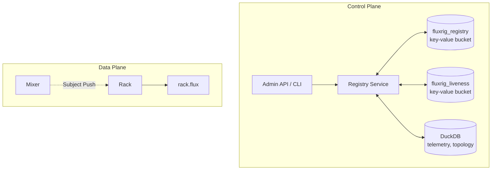
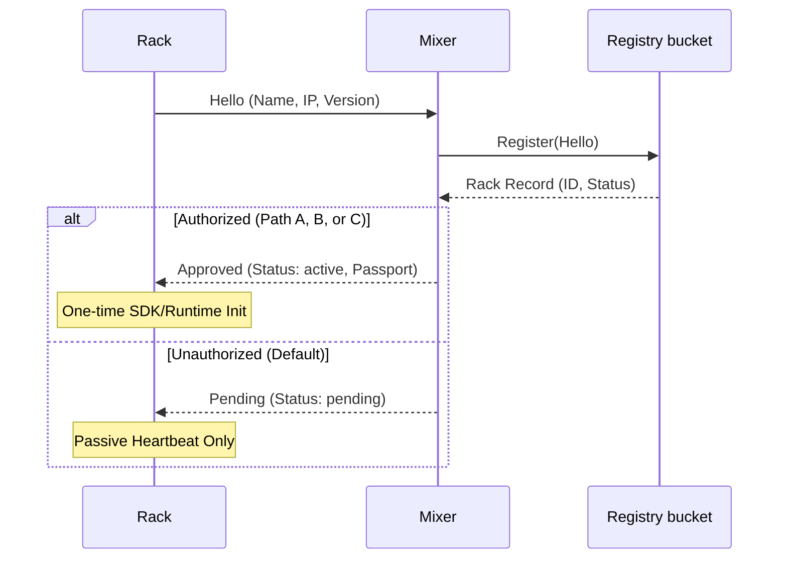

# Identity & registry

The **Identity & State Registry** is the central nervous system for node identity, dynamic configuration distribution, and cluster topology within the **fluxrig** platform. It operates strictly within the Control Plane.

## Philosophy

No system can trust autonomous entities (Racks) to self-assign their own identity because attackers might clone, steal, or spoof them. The Registry solves this by acting as the single source of truth for:

1. **Who** is in the cluster (Identity allocation).
2. **What** each node is allowed to do (State execution logic).
3. **How** nodes prove their identity (Cryptographic Passports).

## Architecture

The Registry runs on the **Mixer**. It keeps its state in two [JetStream key-value buckets](https://docs.nats.io/nats-concepts/jetstream/key-value-store) inside the Mixer's embedded NATS server, and it uses the **Snake Tunnel** to push scenario updates and orchestration signals to edge Racks.



## What the registry keeps

The **registry bucket** (`registry.bucket`, default `fluxrig_registry`) holds:

| Key | Value |
| :--- | :--- |
| `entity.<type>.<machine_id>` | One record per Rack, Mixer and Snake: name, status, secret hash, version, address, first seen, update count. |
| `name.<name>` | The entity that holds a name. Names are unique, and this key is what enforces it. |
| `scenario.<name>` | An imported scenario file. |
| `active` | The name and version of the active scenario. |

The type is `2` (Mixer), `4` (Rack) or `9` (Snake). A Rack's `status` is `pending` (awaiting adoption), `active` or `inactive` (suspended).

Every write that must not lose a concurrent one is a create (the key must be absent) or an update checked against the revision it read. Two Hellos that claim the same name cannot both succeed: one gets a name conflict.

A registration writes the record before it claims the name. A crash between the two steps leaves a record that no name points at, or a rename halfway done. The Mixer sweeps for these at startup and every `registry.sweep_interval`. It deletes a record that never finished registering (its secret never reached a Rack), completes a rename whose new name is free or rolls it back when that name is taken, and deletes a name key whose record is gone. A record younger than `registry.orphan_min_age` is left alone, because it may still be in progress.

The **liveness bucket** (`registry.liveness_bucket`, default `fluxrig_liveness`) holds one key per entity with its last heartbeat. Its entries expire after `registry.liveness_ttl`. See [Heartbeats and presence](#heartbeats-and-presence).

The Mixer's DuckDB keeps telemetry and the topology rows it derives from the active scenario (the scenario, its gears, ports and wires). Each Mixer rebuilds those rows from the scenario; they are not shared.

## Enrollment & adoption lifecycle

A **fluxrig** deployment follows an **Enrollment Architecture**. The process admits Racks to the rig through formal steps. It decouples physical connectivity from functional authorization.

### The deferred adoption mechanism

To ensure deterministic resource allocation and 100% metric attribution, **fluxrig** uses a **Deferred Adoption** lifecycle. 

> [!IMPORTANT]
> A Rack in `pending` status does NOT initialize its **Gear Runtime** or **OpenTelemetry SDK**. It remains in a passive heartbeat-only state until the Mixer officially adopts and activates it.

This architecture ensures that telemetry and processing only begin once the Rack has its permanent, sovereign identity. This results in a clean and consistent operational data stream.

### Enrollment flow



### Adoption paths

A Rack can transition from `pending` to `active` in two ways:

#### Path A: Auto-adoption (configuration)
In development or lab environments, you can configure the Mixer to immediately activate any new Rack that connects. You control this in `fluxrig-mixer.toml`:

```toml
[enrollment]
auto_adopt = true
```

#### Path B: Manual adoption (API/CLI)
In high-security production environments, Racks remain `pending` until an operator explicitly approves them via the Mixer's REST API or the `fluxrig` CLI.

A scenario never changes a Rack's status. Importing or activating a scenario that names a `pending` Rack does not adopt it: the scenario reaches that Rack only after it is approved.

## State distribution (push model)
When a Rack becomes `active`, the Registry issues a **State Envelope (Passport)** that the Cluster Key signs. The Rack stores this passport locally (`rack.flux` by default, set by `base.state_file`). It allows the Rack to skip enrollment in future sessions (Session Recovery).

The registry keeps only a SHA-256 hash of each Rack's secret. The plaintext exists once, when a fresh registration issues it, and only the first passport carries it. The Rack keeps it in a file beside its passport (`rack.flux.secret` by default), readable by the Rack's user only. Every later passport (on approval, suspension, activation or adoption) carries no secret, and the Rack keeps presenting the one it holds.

> [!NOTE]
> **Implementation detail**: the Mixer delivers scenario updates via a high-priority **NATS Subject Push** (`flux.rack.{name}.scenario`). A restarted Mixer reads the active scenario from the registry, as it was registered and sent, and reports it. It does not push it on its own. A Rack that enrolls or rejoins receives it, identical byte for byte to what that Rack received before, so a Rack that already runs it keeps its gears.

`[Roadmap]` Racks watching the registry bucket for their scenario, in place of the push.

## Heartbeats and presence
Each Rack publishes a heartbeat every `rack.heartbeat_interval` (30 seconds by default) to the Mixer. The heartbeat carries the Rack's secret, and the Mixer ignores one whose secret does not match.

An accepted heartbeat records the Rack's presence in the liveness bucket. That entry expires after `registry.liveness_ttl` (90 seconds by default, three heartbeat intervals). The API reports each Rack as `online` while its entry exists, with `last_seen`. The Rack's real-time `stats` (CPU, Memory) stay in the memory of the Mixer that received the heartbeat.

Presence is separate from status. A Rack that stops sending heartbeats stops being `online`. Its status (`pending`, `active`, `inactive`) does not change. `fluxrig admin racks list` shows both for every Rack.
