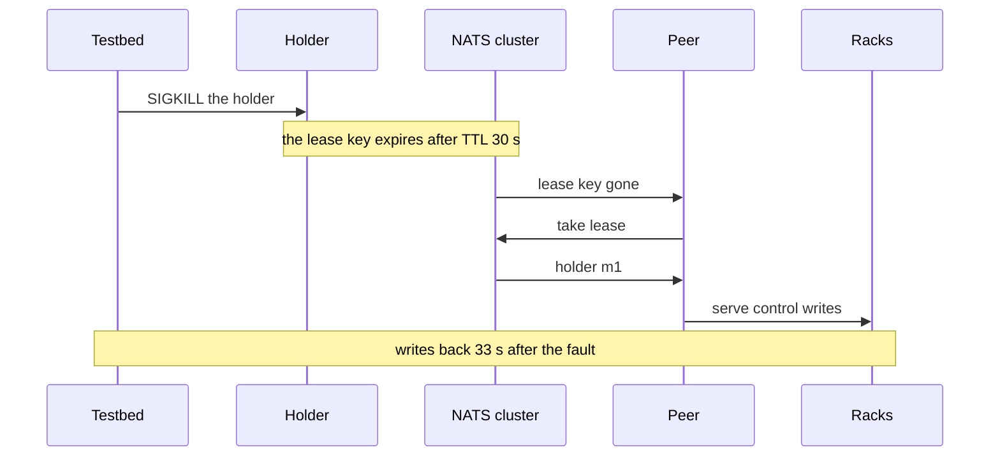
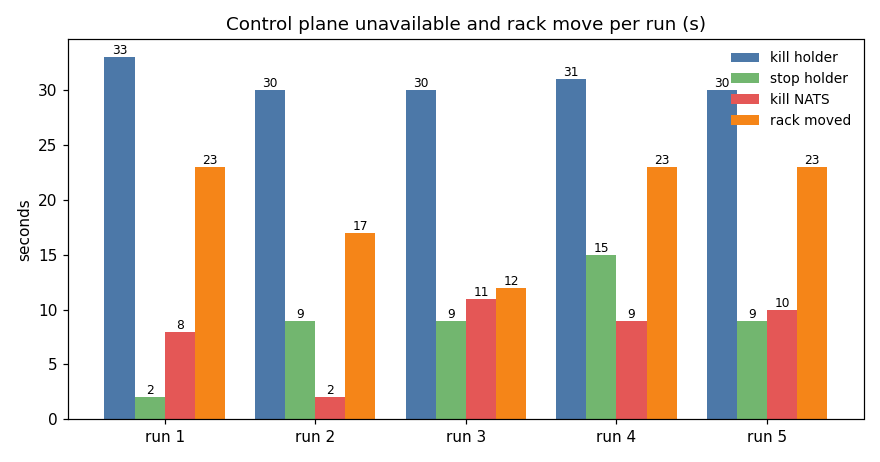
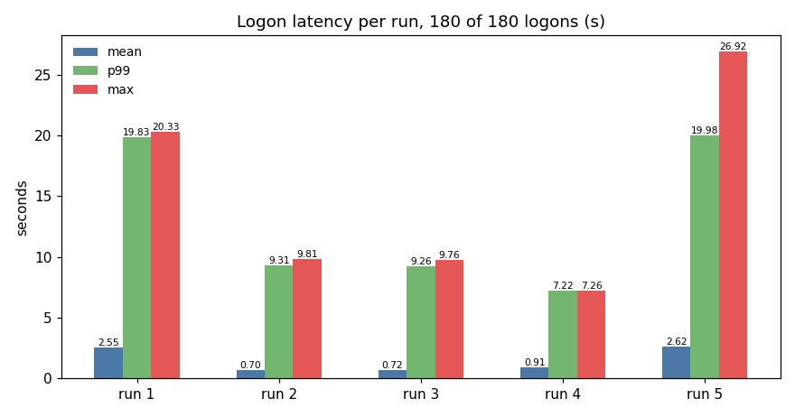

<!-- Copyright (c) 2026 JAAB Tech SAS, Uruguay All Rights Reserved -->
<!-- See https://jaab.tech -->

# Verify failover in a lab

This tutorial runs the HA testbed on one host. It starts three NATS servers in one cluster, three Mixers and two Racks. It adds latency between two sites. It kills the lease holder and shows that control writes come back with no lost message.

## Prerequisites

- Docker on one host with the `sch_netem` kernel module. The testbed shapes traffic between sites with it.
- A checkout of the release with Go binaries built. The script builds the tools that it needs from the checkout.
- About 4 GiB free disk for container stores and result logs.

## What you will build

| Site | NATS | Mixers | Racks |
| :--- | :--- | :--- | :--- |
| a | n1, n2 | m1, m2 | r1 |
| b | n3 | m3 | r2 |

<LikeC4 project="ha-lab" view="deployment" height={460} />

The diagram shows the full lab setup from `test/ha/mixers/docker-compose.yml` and `run.sh`. Every container builds from the `fluxrig-ha-mixer:local` image. NATS servers run the `nats-server` entrypoint. Mixers and Racks run the `fluxrig` entrypoint. The link shaper is `run.sh` itself. It installs tc on every container link and applies netem only to cross-site traffic. It cuts links with iptables for the cut scenarios. The racks hold the gears of the scenario below: the sender on r1 and the receiver on r2. Open any element for its container name and entrypoint.

Site a and site b run on the same host. The `latam` profile adds about 110 ms delay each way between sites, for about 220 ms round trip.

The lab measures the traffic below. A sender on rack-r1 emits one numbered message every 200 ms. A wire on the guaranteed lane carries it to a receiver on rack-r2. `run.sh` writes this scenario on every run. The interval comes from `DATAPLANE_INTERVAL` and defaults to 200 ms. The log processor feeds the telemetry scenario: it counts these lines in the store.

```yaml
meta:
  name: "ha_dataplane"
  version: "1.0.0"
racks:
  - name: "rack-r1"
  - name: "rack-r2"
gears:
  - name: "dp-sender"
    type: "bento"
    deploy: "rack-r1"
    config:
      ports: { outputs: ["out"] }
      bento:
        input:
          generate:
            interval: "200ms"
            mapping: |
              root.seq = count("ha_dataplane")
              root.sent = now()
        pipeline:
          processors:
            # One numbered line of telemetry per message, which the
            # telemetry scenario counts in the store.
            - log:
                level: INFO
                message: 'ha-seq ${! this.seq }'
  - name: "dp-receiver"
    type: "bento"
    deploy: "rack-r2"
    config:
      ports: { inputs: ["in"] }
      bento:
        output:
          stdout: {}
wires:
  - from: "dp-sender.out"
    to: "dp-receiver.in"
    lane: "guaranteed"
```

## Run the lab

1. Run every scenario on a clean network:
```bash
test/ha/mixers/run.sh
```

2. Run the same with cross site latency:
```bash
PROFILE=latam test/ha/mixers/run.sh
```

3. Run two scenarios only to iterate fast:
```bash
SCENARIOS="up kill-holder" PROFILE=latam test/ha/mixers/run.sh
```

4. Run one latam pass with one command:
```bash
make test-ha
```

5. Rotate the telemetry store across five full runs, the release gate:
```bash
for store in s3 nats otlp s3 nats; do
  TELEMETRY="$store" PROFILE=latam test/ha/mixers/run.sh || break
done
```

6. Run the telemetry scenario on one store:
```bash
SCENARIOS="telemetry" TELEMETRY="s3" PROFILE=latam test/ha/mixers/run.sh
```

Steps 1 to 4 run the default scenario set, which excludes the telemetry scenario. Step 6 runs it alone. Step 5 runs everything the gate runs.

With the default secure mode, NATS requires TLS and maps each client certificate to a user. Each Rack gets only the permissions that `fluxrig scenario permissions` writes for the active scenarios. The routes between the NATS servers stay in plaintext. They belong to the NATS operator.

## Kill the holder

1. Start the run with latency:
```bash
SCENARIOS="kill-holder" PROFILE=latam test/ha/mixers/run.sh
```

2. Wait for the script verdict. A peer takes the lease after the holder stops.

3. Read the result dir that the script prints. It holds one file per measurement and every container log per scenario. A failed assertion exits non zero and writes `failures.txt`.

## Read the results

The release lab ran five full runs and passed every scenario. The runs used TLS with client certificates and one NATS user per Rack. The telemetry store rotated across runs through `s3`, `nats`, `otlp`, `s3` and `nats`. Each run started every container from scratch for each scenario.

The host had no other load. It used an Intel i7 CPU with 12 threads and 46 GiB RAM. It ran Docker 29.9.2 and NATS server 2.15.1.

- Control writes come back after the election. In the release lab they came back 30 to 33 s after the kill of the holder. They came back 2 to 11 s after the kill of the NATS server that led the message stream.
- A Rack that lost its NATS server moved to another server in 12 to 23 s. Both Racks stayed online.
- The traffic between the Racks loses nothing. The script sends one numbered message every 200 ms from r1 to r2 and shows the sequence has no gap. A redelivery can arrive twice: the lane delivers at least once.
- No acknowledged control write is lost. The script writes a control value before the fault and reads it back after.
- All 180 logons arrive in the events scenario. The slowest arrived between 7.3 and 26.9 s in the release lab.
- The telemetry scenario kills the writer of the store. The store then holds each numbered Rack log line one time.

These numbers describe one lab host with no other load. They are not guarantees. Your host gives its own numbers. Compare runs on the same host with the same profile.

## Measured runs

The gate series ran five full runs in a row at the latam profile. All five passed every scenario. The charts and the flow below come from those runs. Clean reruns: run 4, run 5. The harness interrupted the first attempts, not the lab.

Every run executes the same scenario set at the latam profile. It covers up, kill holder, stop holder, cut holder, and kill NATS. It also covers the Rack cut, events failover, Wasm catalog, probe, and telemetry. The scenarios stay fixed. Only the telemetry store rotates.

| Run | Telemetry store | Profile | Result |
|:--|:--|:--|:--|
| run1 | s3 | latam | pass |
| run2 | nats | latam | pass |
| run3 | otlp | latam | pass |
| run4 | s3 | latam | pass |
| run5 | nats | latam | pass |



| Control plane per run | Logons per run |
| :--- | :--- |
|  |  |
| *Seconds without control writes after each fault, and seconds until the cut Rack moved. Kill holder waits out the 30 s lease in every run.* | *Mean, p99 and max logon latency with all 180 logons arriving in every run.* |

Every run kept all acknowledged writes and delivered all 180 logons.

| Run | Kill holder | Stop holder | Kill NATS | Rack moved | Logons p99 | Logons max |
|:--|:--|:--|:--|:--|:--|:--|
| run1 | 33 s | 2 s | 8 s | 23 s | 19.8 s | 20.3 s |
| run2 | 30 s | 9 s | 2 s | 17 s | 9.3 s | 9.8 s |
| run3 | 30 s | 9 s | 11 s | 12 s | 9.3 s | 9.8 s |
| run4 | 31 s | 15 s | 9 s | 23 s | 7.2 s | 7.3 s |
| run5 | 30 s | 9 s | 10 s | 23 s | 20.0 s | 26.9 s |

## Next steps

- Read [High availability](../reference/high_availability.md) for the lease, the NATS cluster settings and the failure modes.
- Read [Operating fluxrig](../reference/operations.md) for backups and key handling before you run more than one Mixer outside the lab.
